# Architecture

How the Duck Store is put together, as diagrams. The [README](../README.md) explains the decisions behind it (interpretation calls, concurrency, why each pattern), and `CLAUDE.md` is the running record of those decisions. This file shows the structure: which pieces exist, how they depend on each other, and what happens on the main requests.

The diagrams are Mermaid, so GitHub renders them in place. Class diagrams show the members that matter for the design, not every field, and async methods are shown with the type they resolve to.

- [System overview](#system-overview)
- [Backend](#backend)
  - [Modules](#modules)
  - [Request path and errors](#request-path-and-errors)
  - [Data model](#data-model)
  - [Duck CRUD](#duck-crud)
  - [Orders, packaging and pricing](#orders-packaging-and-pricing)
  - [Pricing pipeline](#pricing-pipeline)
  - [Adding a duck](#adding-a-duck)
  - [Editing a duck](#editing-a-duck)
  - [Placing an order](#placing-an-order)
- [Frontend](#frontend)
  - [Component tree](#component-tree)
  - [Data layer](#data-layer)
  - [Dialogs](#dialogs)
  - [Editing from the UI](#editing-from-the-ui)
- [Tests and CI](#tests-and-ci)
- [Where things live](#where-things-live)

## System overview

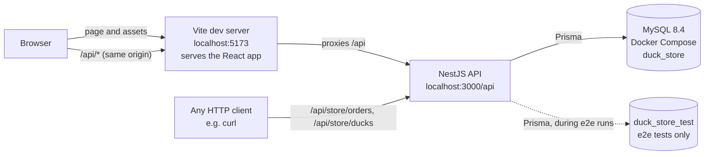

The web app only talks to `/api/ducks`. The Store module has no frontend, so its routes (`/api/store/ducks` and `/api/store/orders`) are called directly. In development the Vite proxy keeps every browser call same-origin, so CORS never comes into play. `main.ts` also enables CORS for `WEB_ORIGIN` (default `http://localhost:5173`).

## Backend

### Modules

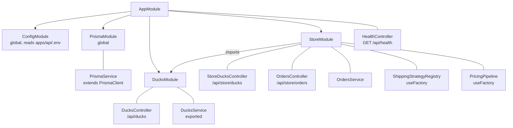

`DucksModule` exports `DucksService`, and `StoreModule` imports it, so the Store's CRUD routes and the order flow use exactly the same duck logic as the Warehouse. `ShippingStrategyRegistry` and `PricingPipeline` are plain classes with default constructor arguments, so `StoreModule` builds them with `useFactory` instead of Nest's injector. Tests can still swap them with `overrideProvider`.

### Request path and errors

`configureApp` (in `app.setup.ts`) applies the same setup to the running API and to the e2e tests: the `/api` prefix, the global `ValidationPipe` and the global `PrismaConflictFilter`.

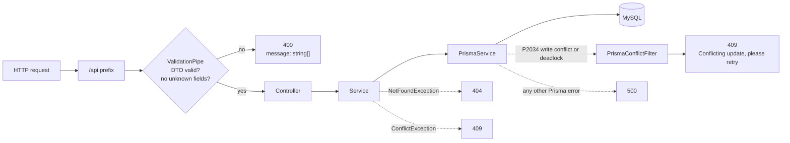

Every error uses Nest's default shape, `{ statusCode, message, error }`. `ParseIntPipe` on `:id` turns a non-integer id into a 400 as well.

### Data model

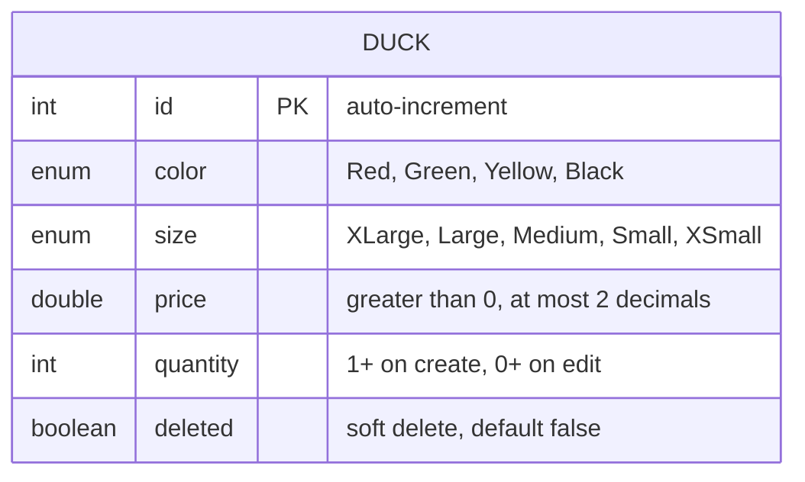

There is one table, `ducks`, with an index on `(color, size, price, deleted)` for the merge lookup. Rows are never physically deleted: `deleted = true` keeps them as history, and every read and match filters on `deleted = false`. Orders are not stored. Placing one only decrements a duck's `quantity`.

### Duck CRUD

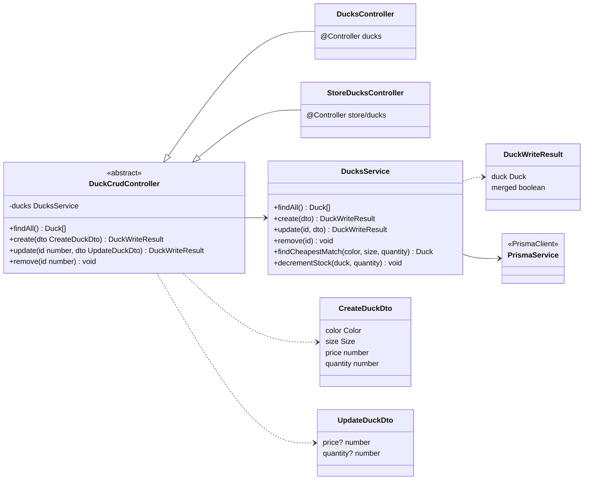

The handlers live once in `DuckCrudController`. Each subclass only adds `@Controller` with its path, so `/api/ducks` and `/api/store/ducks` can't drift apart in validation, status codes or response shape. `create` sets 201 or 200 from `merged`, and `remove` returns 204. `UpdateDuckDto` doesn't declare color or size, so the `ValidationPipe` rejects them, and a custom `HasAnyEditableField` validator requires at least one of price or quantity.

### Orders, packaging and pricing

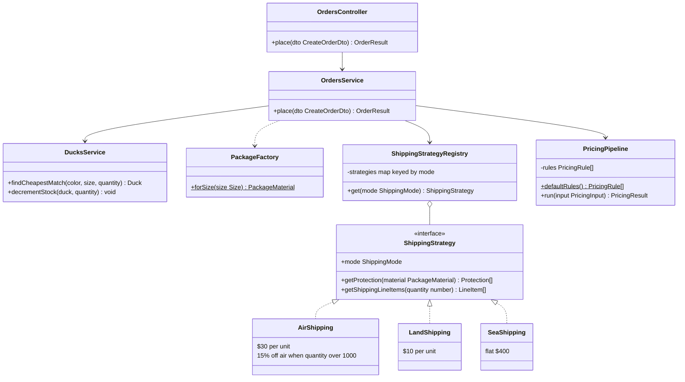

- **Factory.** `PackageFactory.forSize` maps size to material: XLarge and Large get WOOD, Medium gets CARDBOARD, Small and XSmall get PLASTIC.
- **Strategy and registry.** Each `ShippingStrategy` owns its mode's protection and shipping lines, and the registry looks strategies up by mode in a map. Protection for AIR is polystyrene balls for wood and cardboard, and bubble wrap for plastic. LAND is always polystyrene balls. SEA is always moisture-absorbing beads plus bubble wrap.

### Pricing pipeline

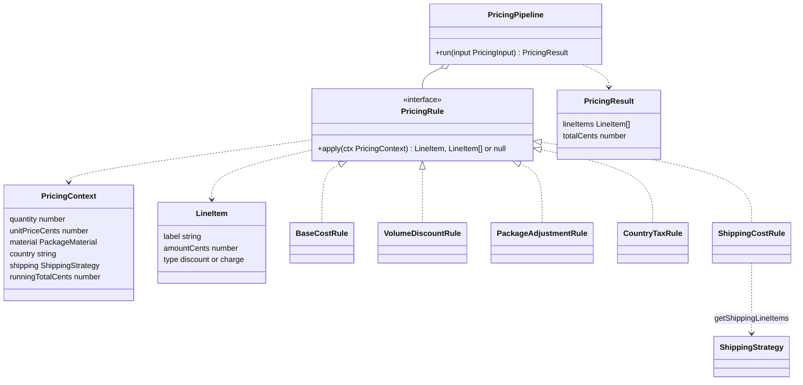

`run` starts the running total at 0, gives each rule the context plus the total so far, appends whatever line items the rule returns (skipping null), and adds them to the total. So `totalCents` is always exactly the sum of the line items. All amounts are integer cents, and `percentOf` rounds each percentage half-up on the magnitude.

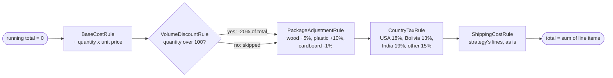

The percentages compound in this order. Shipping runs last, so no percentage ever applies to it. `CountryTaxRule` trims and upper-cases the country and maps aliases such as `US` and `United States` to `USA` before looking up the rate.

### Adding a duck

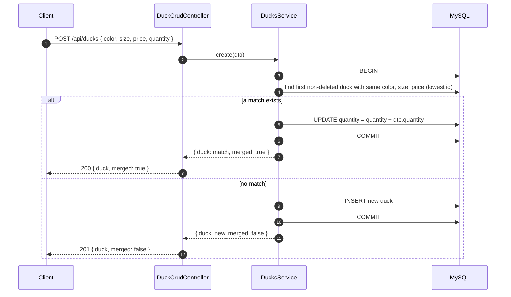

Two concurrent adds of a combination that doesn't exist yet can both miss the lookup and insert twins. That race is accepted (see the README), and the next edit of either twin merges them.

### Editing a duck

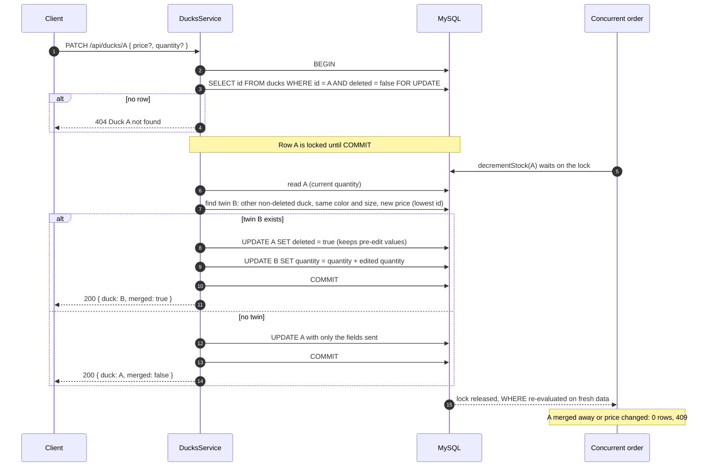

If two edits move ducks onto each other's prices at the same time, each holds its own row lock and waits on the other's. MySQL rolls one back, Prisma reports P2034, and `PrismaConflictFilter` turns it into a 409.

### Placing an order

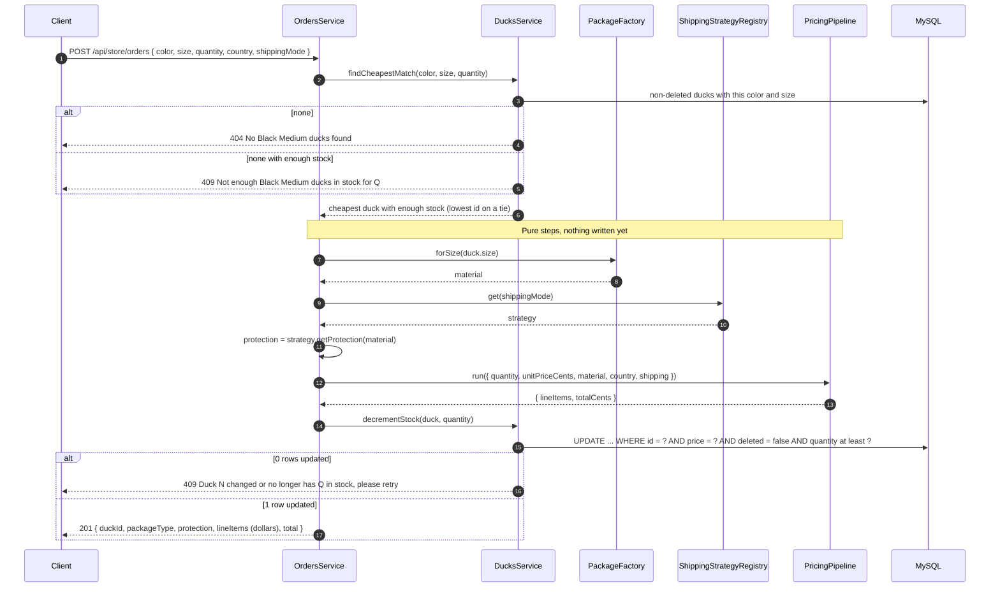

Packaging and pricing are pure, so they run before the only write. If the conditional decrement loses a race to another order, an edit or a delete, the 409 is returned and nothing else has changed. The price in the `WHERE` means an order is never charged a price the duck no longer has.

## Frontend

### Component tree

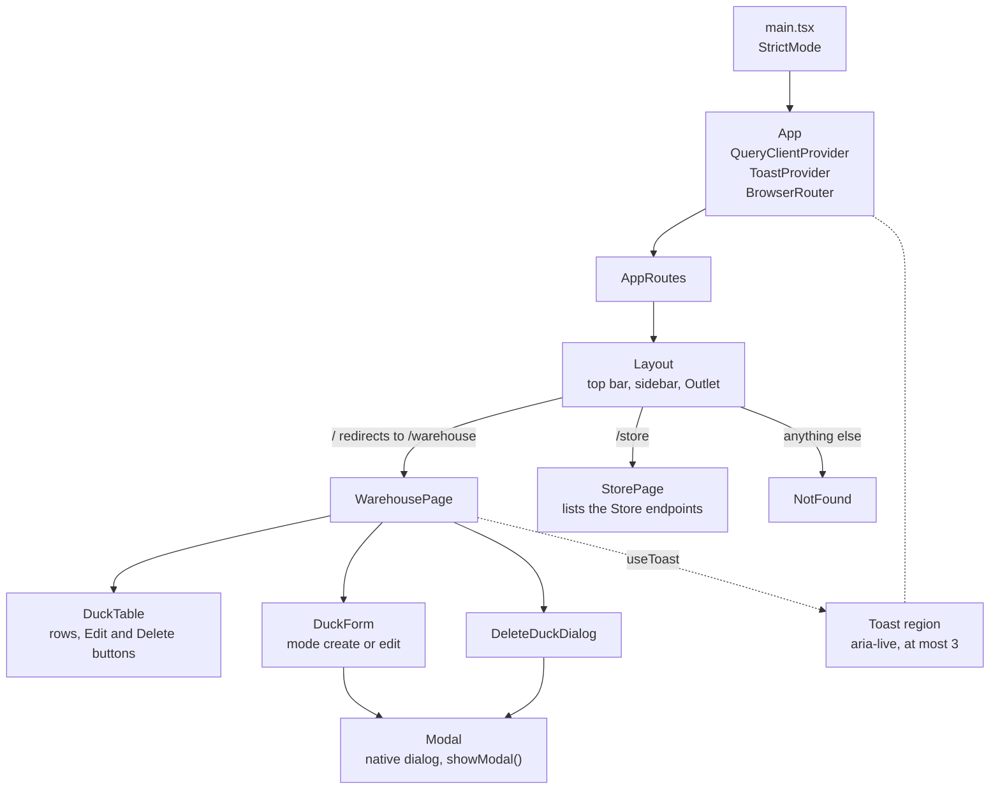

Add and Edit share `DuckForm`. In edit mode color and size are disabled, and only the changed fields are sent. Validation (`duckFormValidation.ts`) mirrors the API's DTOs, and toast copy lives in `messages.ts`. `Modal` is mounted to open and unmounted to close, and on close it returns focus to its trigger, or to `focusFallback` (the "Duck Inventory" heading) if the trigger is gone.

### Data layer

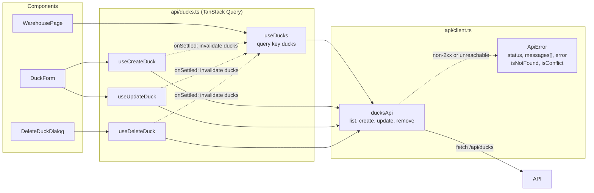

Every mutation invalidates the ducks list when it settles, on success or failure, and returns the refetch promise. That keeps the mutation pending until the list has refreshed, so a deleted or merged row is already gone when its dialog closes. A failed call always throws `ApiError`: `messages` is always an array, a non-JSON body falls back to the status, and an unreachable server is `status: 0`.

### Dialogs

`WarehousePage` keeps at most one dialog open, as a single piece of state.

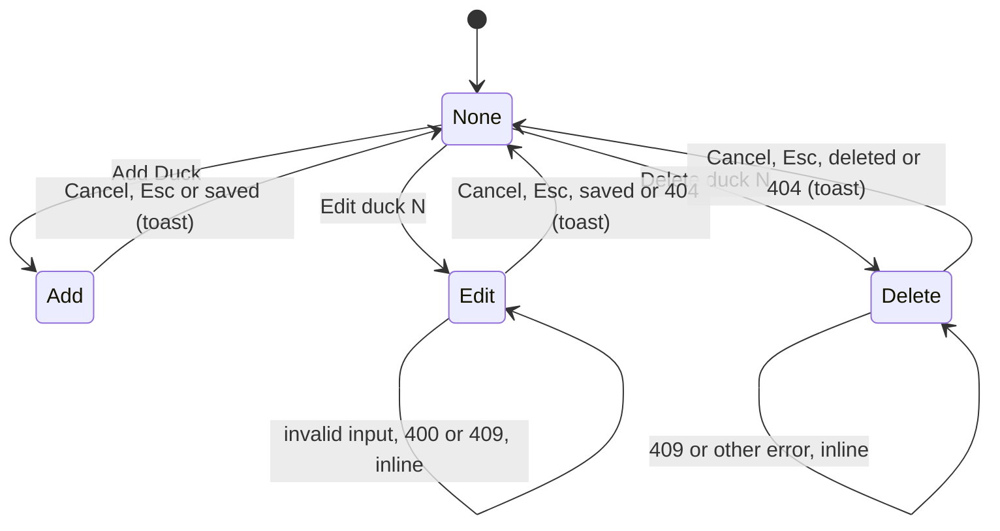

Esc and the backdrop are blocked while a request is pending, so a result is never dropped. Toasts are shown after the dialog closes, because a modal dialog's top layer would cover them.

### Editing from the UI

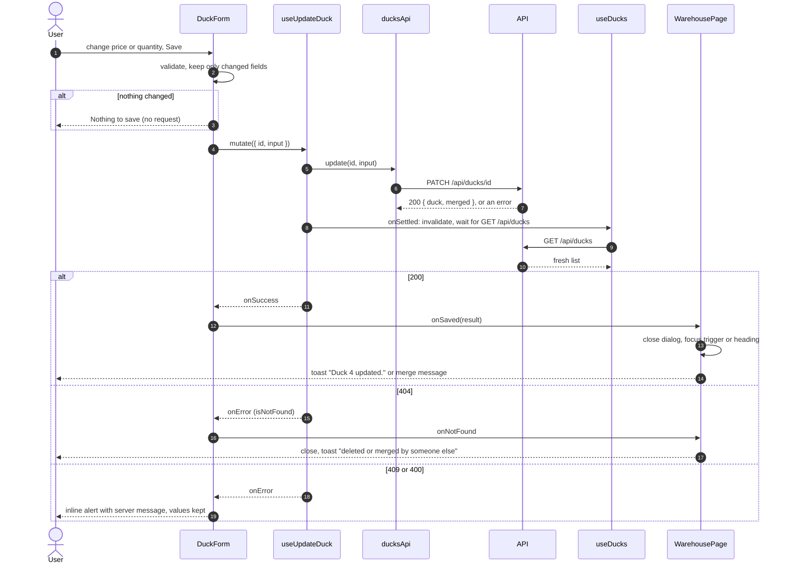

## Tests and CI

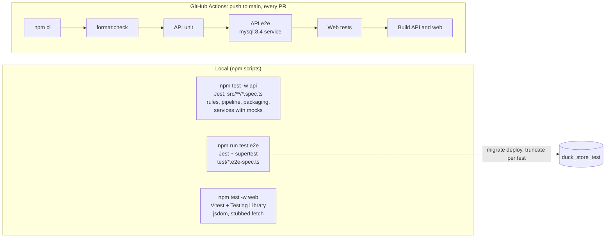

The e2e tests boot the full Nest app through `createTestApp`, which uses the same `configureApp` as `main.ts`, so they exercise the real prefix, validation and error mapping. The web tests render with a no-retry query client, toasts and a memory router (`test/render.tsx`), and stub `fetch` per test (`test/fetch.ts`).

## Where things live

| Concern                           | File                                                                     |
| --------------------------------- | ------------------------------------------------------------------------ |
| Shared app setup                  | `apps/api/src/app.setup.ts`                                              |
| Duck CRUD routes                  | `apps/api/src/ducks/duck-crud.controller.ts`                             |
| Merge, edit lock, stock decrement | `apps/api/src/ducks/ducks.service.ts`                                    |
| Conflict and deadlock mapping     | `apps/api/src/prisma/prisma-conflict.filter.ts`                          |
| Order flow                        | `apps/api/src/store/orders/orders.service.ts`                            |
| Package material                  | `apps/api/src/store/packaging/package.factory.ts`                        |
| Shipping modes                    | `apps/api/src/store/packaging/strategies/`                               |
| Pricing rules and pipeline        | `apps/api/src/store/pricing/`                                            |
| Money helpers                     | `apps/api/src/store/pricing/money.ts`                                    |
| Schema and seed                   | `apps/api/prisma/schema.prisma`, `apps/api/prisma/seed.ts`               |
| Routes and providers              | `apps/web/src/App.tsx`                                                   |
| Fetch client and query hooks      | `apps/web/src/api/client.ts`, `apps/web/src/api/ducks.ts`                |
| Warehouse page and dialogs        | `apps/web/src/features/warehouse/`                                       |
| Modal and toasts                  | `apps/web/src/components/Modal.tsx`, `apps/web/src/components/Toast.tsx` |
